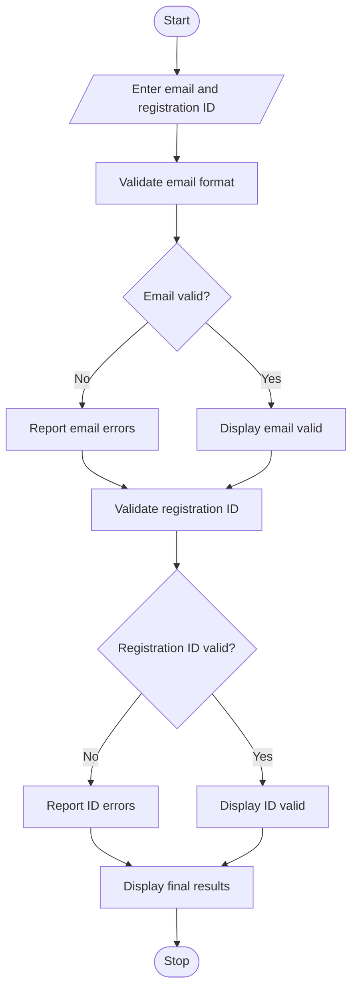

# Student Email and Identifier Validation Using Python

## 1. Problem Statement

Develop a Python program to validate student email addresses and registration identifiers based on predefined formatting rules.

The program should:

1. Validate student email-like strings.
2. Check whether the email contains the required components: username, `@` symbol, domain name, and extension.
3. Detect malformed separators, such as multiple `@` symbols, consecutive dots, or dots at invalid positions.
4. Identify invalid character groups in the username and domain.
5. Validate student registration identifiers against a specified format.
6. Report missing components and display whether each input is valid or invalid.

Assumed validation rules:

- Email format: `username@domain.extension`
- Username: letters, digits, underscores, and dots.
- Domain: letters, digits, and hyphens.
- Extension: 2–6 alphabetic characters.
- Registration ID format: `CSE2026001` (3 uppercase letters, 4 digits, and 3 digits).

## 2. Algorithm

1. Start the program.
2. Read the student email and registration ID.
3. Split the email using the `@` symbol.
4. Check whether the email contains exactly one `@` symbol.
5. Validate the username, domain, and extension.
6. Check for missing components and malformed separators.
7. Validate the registration ID using the required pattern.
8. Display validation results and error messages.
9. Stop the program.


## 5. Sample Input

```
Enter student email: student123@gmail.com
Enter registration ID: CSE2026001
```

## 6. Sample Output

```
--- Validation Results ---

Email: VALID
Registration ID: VALID
```

Example with invalid inputs:

Sample Input:

```
Enter student email: student@@gmail..com
Enter registration ID: CS2026A
```

Sample Output:

```
--- Validation Results ---

Email: INVALID
- Multiple @ symbols found

Registration ID: INVALID
- Registration ID must contain 10 characters
```

## 7. Mermaid Flowchart Code


## 8. Result

The Python program successfully validates student email-like strings and registration identifiers. It identifies missing components, malformed separators, invalid characters, and incorrect registration ID formats, and displays appropriate validation messages.

Note: The email and registration ID rules used here are illustrative. Actual institutional formats can be substituted as required.
