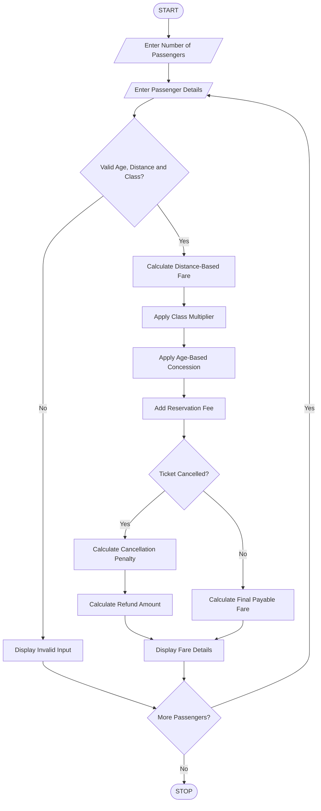

# Railway Fare and Reservation Calculator Using Python

## 1. Problem Statement

Develop a Python program to calculate railway fares for multiple passengers based on travel distance, travel class, and age-based concessions. The program should calculate fares using distance slabs, add reservation fees, apply eligible age concessions, and calculate cancellation penalties when a ticket is cancelled. Finally, display the total fare, concession, reservation fee, cancellation penalty, and final payable or refundable amount for each passenger.

## 2. Algorithm

1. Start the program.
2. Read the number of passengers.
3. For each passenger, enter:
   - Passenger name.
   - Age.
   - Travel distance in kilometres.
   - Travel class.
   - Ticket status (Booked/Cancelled).
4. Calculate the basic fare based on distance:
   - Up to 100 km – ₹2 per km.
   - 101–500 km – ₹1.50 per km.
   - Above 500 km – ₹1 per km.
5. Calculate the fare according to the selected travel class:
   - Sleeper – 1.0 multiplier.
   - AC 3 Tier – 2.0 multiplier.
   - AC 2 Tier – 3.0 multiplier.
   - AC First Class – 4.0 multiplier.
6. Apply age-based concession:
   - Below 5 years – Free.
   - 60 years and above – 20% concession.
   - Others – No concession.
7. Add a reservation fee of ₹40.
8. If the ticket is cancelled, apply a cancellation penalty of 25% of the fare after concession.
9. Calculate the final payable or refundable amount.
10. Display the passenger-wise fare details.
11. Stop.

Assumed fare rules are used for this programming exercise.


## 5. Sample Input

```
Enter number of passengers: 2

Passenger 1
Enter passenger name: Ravi
Enter age: 65
Enter travel distance (km): 600
Enter travel class: AC3
Enter ticket status (Booked/Cancelled): booked

Passenger 2
Enter passenger name: Priya
Enter age: 30
Enter travel distance (km): 300
Enter travel class: SLEEPER
Enter ticket status (Booked/Cancelled): cancelled
```

## 6. Sample Output

```
--- RAILWAY TICKET DETAILS ---
Passenger: Ravi
Travel Class: AC3
Distance: 600.0 km
Basic Fare: 2100.0
Age Concession: 420.0
Reservation Fee: 40
Final Payable: 1720.0

--- CANCELLATION DETAILS ---
Passenger: Priya
Basic Fare: 500.0
Concession: 0
Reservation Fee: 40
Cancellation Penalty: 125.0
Refund Amount: 415.0

Railway Fare Calculation Completed.
```

## 7. Mermaid Flowchart Code



## 8. Result

The Python program successfully calculates railway fares for multiple passengers using distance slabs and travel classes, applies age-based concessions, adds reservation fees, and calculates cancellation penalties and refund amounts.

Note: The fare rates, concessions, reservation fee, and cancellation penalty are assumed values for academic purposes. Actual railway fares and cancellation rules may differ.
