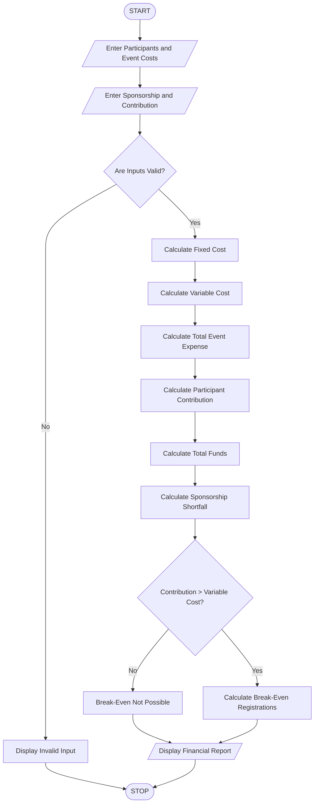

# Campus Event Financial Planning Using Python

## 1. Problem Statement

Develop a Python program to calculate the total expenses of a campus event, including venue, equipment, catering, transport, and certificate costs. Calculate the total budget, participant contribution, sponsorship amount, and any sponsorship shortfall. Also determine the minimum number of registrations required to break even and ensure that the event expenses are covered.

## 2. Algorithm

1. Start the program.
2. Enter the number of participants.
3. Enter venue, equipment, catering, transport, and certificate costs.
4. Enter the sponsorship amount.
5. Validate that all inputs are non-negative.
6. Calculate the total event expenses.
7. Calculate the cost per participant.
8. Calculate the participant contribution.
9. Calculate the sponsorship shortfall, if any.
10. Calculate the minimum registrations required to break even.
11. Display the total expenses, contributions, sponsorship shortfall, and break-even registrations.
12. Stop.


## 5. Sample Input

```
Enter number of participants: 100
Enter venue cost: 10000
Enter equipment cost: 5000
Enter catering cost per participant: 200
Enter transport cost per participant: 50
Enter certificate cost per participant: 50
Enter sponsorship amount: 10000
Enter contribution per participant: 400
```

## 6. Sample Output

```
--- CAMPUS EVENT FINANCIAL REPORT ---
Total Participants: 100
Fixed Cost: 15000.0
Variable Cost: 30000.0
Total Event Expense: 45000.0
Participant Contribution: 40000.0
Sponsorship: 10000.0
Sponsorship Shortfall: 0
Break-Even Registrations: 17
```


## 7. Mermaid Flowchart Code



## 8. Result

The Python program successfully calculates campus event expenses, participant contributions, sponsorship shortfalls, and minimum break-even registrations based on the given financial details.

Note: All amounts and financial rules are assumed for this academic programming exercise.
