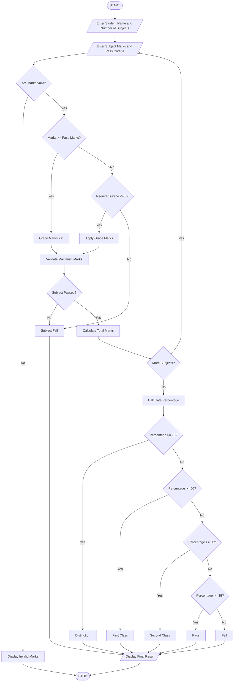

# Examination Result and Grace-Mark Validation Using Python

## 1. Problem Statement

Develop a Python program to process marks obtained by a student across multiple subjects. Check subject-wise pass criteria, apply grace marks according to a specified policy, and ensure that the awarded marks do not exceed the maximum marks. Finally, calculate total marks, percentage, and generate the student's final result classification such as Pass, Fail, or Distinction.

## 2. Algorithm

1. Start the program.
2. Enter the student's name and number of subjects.
3. Enter maximum marks, obtained marks, and minimum pass marks for each subject.
4. Validate the marks to ensure they are within the permitted range.
5. Check whether the student has passed each subject.
6. If the student fails in a subject by a small margin, apply grace marks according to the policy.
7. Ensure that grace marks do not exceed the maximum marks.
8. Calculate the total marks and percentage.
9. Determine the final result:
   - 75% and above – Distinction.
   - 60% and above – First Class.
   - 50% and above – Second Class.
   - 35% and above – Pass.
   - Below 35% or any failed subject – Fail.
10. Display subject-wise marks and final classification.
11. Stop.


## 5. Sample Input

```
Enter student name: Ravi
Enter number of subjects: 3

Subject 1
Enter subject name: Python
Enter maximum marks: 100
Enter obtained marks: 78
Enter minimum pass marks: 35

Subject 2
Enter subject name: Java
Enter maximum marks: 100
Enter obtained marks: 32
Enter minimum pass marks: 35

Subject 3
Enter subject name: DBMS
Enter maximum marks: 100
Enter obtained marks: 85
Enter minimum pass marks: 35
```

## 6. Sample Output

```
Subject: Python
Grace Marks: 0
Final Marks: 78
Result: Pass

Subject: Java
Grace Marks: 3
Final Marks: 35
Result: Pass

Subject: DBMS
Grace Marks: 0
Final Marks: 85
Result: Pass

----- EXAMINATION RESULT -----
Student Name: Ravi
Total Marks: 198 / 300
Percentage: 66.0 %
Final Classification: First Class
```

## 7. Mermaid Flowchart Code


## 8. Result

The Python program successfully processes marks across multiple subjects, validates maximum marks, applies eligible grace marks, checks subject-wise pass criteria, and generates the final examination classification.

Note: The grace-mark limit (5 marks) and classification percentages used here are assumed for academic purposes. Actual examination regulations may have different rules. Grace marks are applied only to bring a student up to the minimum passing marks in an individual subject.
