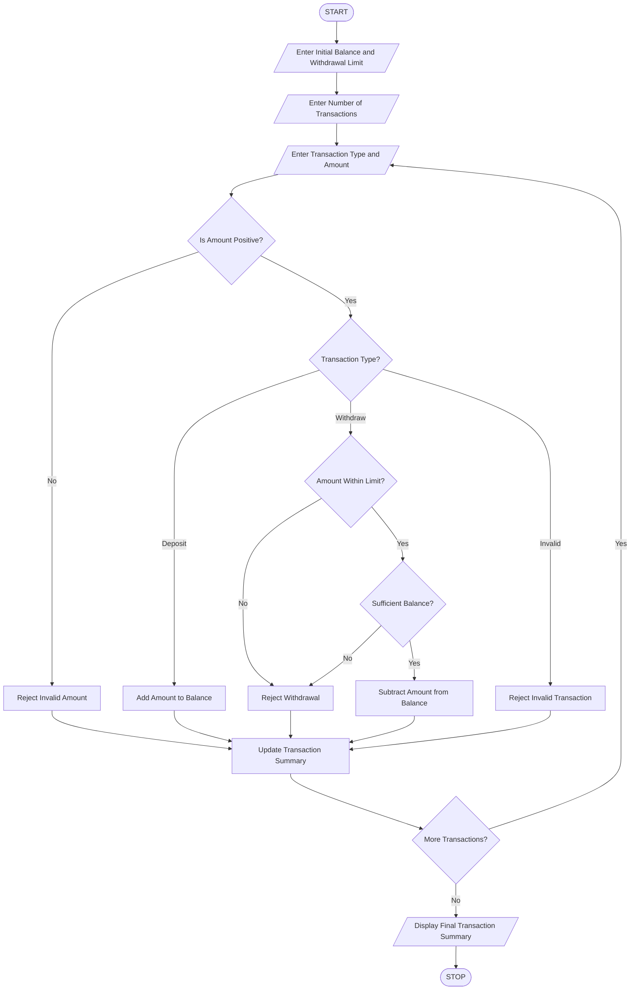

# ATM Transaction Sequence Simulation Using Python

## 1. Problem Statement

Develop a Python program to simulate ATM transactions by processing a sequence of deposits and withdrawals. Maintain the account balance after every transaction, enforce withdrawal limits, reject invalid transactions such as negative amounts or insufficient balance, and generate a final transaction summary showing total deposits, total withdrawals, successful transactions, rejected transactions, and closing balance.

## 2. Algorithm

1. Start the program.
2. Enter the initial account balance.
3. Enter the maximum withdrawal limit.
4. Enter the number of transactions.
5. Repeat for each transaction:
   - Select Deposit or Withdrawal.
   - Enter the transaction amount.
   - Validate that the amount is positive.
   - If Deposit, add the amount to the balance.
   - If Withdrawal, check the withdrawal limit and available balance.
   - Reject invalid transactions.
6. Update the account balance after successful transactions.
7. Calculate total deposits and withdrawals.
8. Count successful and rejected transactions.
9. Display the final transaction summary and closing balance.
10. Stop.


## 5. Sample Input

```
Enter initial balance: Rs. 10000
Enter maximum withdrawal limit: Rs. 5000
Enter number of transactions: 4

Transaction 1
Enter type (Deposit/Withdraw): deposit
Enter amount: Rs. 2000

Transaction 2
Enter type (Deposit/Withdraw): withdraw
Enter amount: Rs. 3000

Transaction 3
Enter type (Deposit/Withdraw): withdraw
Enter amount: Rs. 6000

Transaction 4
Enter type (Deposit/Withdraw): withdraw
Enter amount: Rs. 2000
```

## 6. Sample Output

```
Transaction 1
Deposit successful
Current Balance: Rs. 12000.0

Transaction 2
Withdrawal successful
Current Balance: Rs. 9000.0

Transaction 3
Rejected: Withdrawal limit exceeded
Current Balance: Rs. 9000.0

Transaction 4
Withdrawal successful
Current Balance: Rs. 7000.0

----- ATM TRANSACTION SUMMARY -----
Total Deposits: Rs. 2000.0
Total Withdrawals: Rs. 5000.0
Successful Transactions: 3
Rejected Transactions: 1
Closing Balance: Rs. 7000.0
```

## 7. Mermaid Flowchart Code


## 8. Result

The Python program successfully simulates ATM deposit and withdrawal transactions, maintains the account balance, enforces withdrawal limits, rejects invalid transactions, and generates a final transaction summary.

Note: The withdrawal limit is assumed to be a per-transaction limit for this program.
