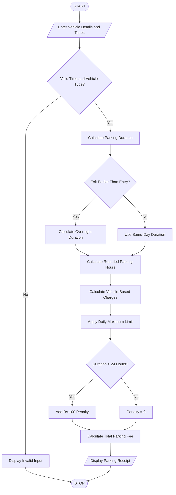

# Smart Parking Fee Management Using Python

## 1. Problem Statement

Develop a Python program to calculate parking charges based on vehicle entry time, exit time, and vehicle category. The program should calculate parking duration, apply different hourly rates for cars, bikes, and buses, consider overnight parking and daily maximum limits, and apply penalties for invalid parking conditions. It should also validate time inputs and display the total parking fee.

## 2. Algorithm

1. Start the program.
2. Enter vehicle number and vehicle category.
3. Enter parking entry time and exit time in HH:MM format.
4. Validate the time format and vehicle category.
5. Calculate the total parking duration.
6. If the exit time is earlier than the entry time, consider overnight parking.
7. Calculate the parking charges based on vehicle category:
   - Bike – ₹10 per hour.
   - Car – ₹20 per hour.
   - Bus – ₹40 per hour.
8. Round the parking duration up to the next complete hour.
9. Apply the daily maximum charge:
   - Bike – ₹100 per day.
   - Car – ₹200 per day.
   - Bus – ₹400 per day.
10. Apply a ₹100 penalty if parking duration exceeds 24 hours.
11. Calculate and display the final parking fee.
12. Stop.

## 5. Sample Input

```
Enter vehicle number: AP39AB1234
Enter vehicle type (Bike/Car/Bus): Car
Enter entry time (HH:MM): 22:00
Enter exit time (HH:MM): 06:00
```

## 6. Sample Output

```
----- PARKING RECEIPT -----
Vehicle Number: AP39AB1234
Vehicle Type: Car
Parking Duration: 8.0 hours
Hourly Rate: Rs. 20
Parking Charge: Rs. 160
Penalty: Rs. 0
Total Parking Fee: Rs. 160
```

## 7. Mermaid Flowchart Code


## 8. Result

The Python program successfully calculates parking fees based on vehicle category, entry and exit times, overnight parking, daily maximum limits, and penalty conditions. It also validates time inputs and generates a parking receipt.

Note: The hourly rates, daily limits, and penalty amounts are assumed for this academic exercise. The program treats entry and exit times as belonging to the same day unless the exit time is earlier, in which case it assumes overnight parking.
