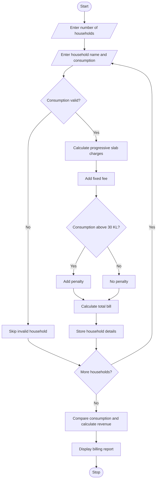

# Progressive Water Tariff Analysis Using Python

## 1. Problem Statement

Develop a Python program to calculate water bills for multiple households based on their monthly water consumption.

The program should:

1. Accept the number of households and their water consumption in kilolitres (KL).
2. Calculate water charges using progressive consumption slabs.
3. Add fixed monthly service fees.
4. Apply penalties for excessive water consumption.
5. Calculate the total bill for each household.
6. Compare household consumption patterns.
7. Identify households with excessive water usage.
8. Display the highest consumer and total revenue collected.

Assumed Water Tariff Rules:

| Consumption slab   | Rate per KL |
| ------------------ | ----------- |
| First 10 KL        | ₹5          |
| Next 10 KL (11–20) | ₹8          |
| Next 10 KL (21–30) | ₹12         |
| Above 30 KL        | ₹15         |

Additional charges:

- Fixed monthly fee: ₹50 per household.
- Excessive usage penalty: ₹100 if consumption exceeds 30 KL.
- Excessive usage threshold: More than 30 KL.

## 2. Algorithm

1. Start the program.
2. Read the number of households.
3. For each household:
   - Read household name and water consumption.
   - Validate that consumption is non-negative.
   - Calculate charges using progressive tariff slabs.
   - Add the fixed monthly fee.
   - Apply a penalty if consumption exceeds 30 KL.
   - Calculate the final bill.
4. Store each household's consumption and bill.
5. Compare consumption among households.
6. Identify the highest consumer.
7. Identify households exceeding 30 KL.
8. Calculate total revenue.
9. Display the household-wise billing report.
10. Stop the program.

## 3. Progressive Tariff Calculation

Each consumption slab is charged at its own rate rather than applying one rate to the entire consumption.

Illustrative tariff structure

First 10 KL

₹5 / KL

₹50 maximum

Next 10 KL

₹8 / KL

₹80 maximum

Next 10 KL

₹12 / KL

₹120 maximum

Above 30 KL

₹15 / KL

Additional charge

For example, if a household consumes 35 KL:

- First 10 KL = 10 × ₹5 = ₹50
- Next 10 KL = 10 × ₹8 = ₹80
- Next 10 KL = 10 × ₹12 = ₹120
- Remaining 5 KL = 5 × ₹15 = ₹75
- Fixed fee = ₹50
- Excessive usage penalty = ₹100

Total bill = ₹475

## 6. Sample Input

```
Enter number of households: 3

Household 1
Enter household name: House_A
Enter water consumption (KL): 8

Household 2
Enter household name: House_B
Enter water consumption (KL): 20

Household 3
Enter household name: House_C
Enter water consumption (KL): 35
```

## 7. Sample Output

```
------ WATER BILL REPORT ------

Household: House_A
Consumption: 8.0 KL
Water Charge: Rs. 40.0
Fixed Fee: Rs. 50
Penalty: Rs. 0
Total Bill: Rs. 90.0

Household: House_B
Consumption: 20.0 KL
Water Charge: Rs. 130.0
Fixed Fee: Rs. 50
Penalty: Rs. 0
Total Bill: Rs. 180.0

Household: House_C
Consumption: 35.0 KL
Water Charge: Rs. 325.0
Fixed Fee: Rs. 50
Penalty: Rs. 100
Total Bill: Rs. 475.0

------ CONSUMPTION ANALYSIS ------

Highest Consumer: House_C
Highest Usage: 35.0 KL

Excessive Usage Households:
House_C - 35.0 KL

Total Revenue: Rs. 745.0
Households Billed: 3
```

## 8. Mermaid Flowchart Code


## 9. Result

The Python program successfully calculates water bills for multiple households using progressive tariff slabs, fixed fees, and excessive usage penalties. It compares household consumption, identifies excessive water users, finds the highest consumer, and calculates total revenue.

Note: All tariff rates, fixed fees, and penalties are illustrative assumptions. Actual water-board tariff policies can be substituted.
