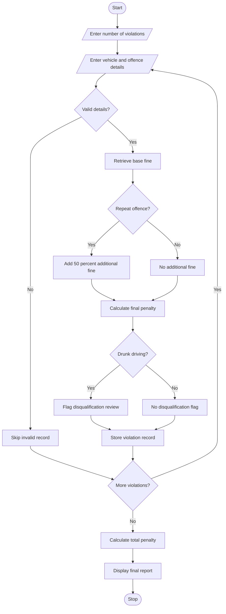

# Traffic Violation Penalty Calculator Using Python

## 1. Problem Statement

Develop a Python program to calculate traffic violation penalties for multiple vehicles based on vehicle category, offence type, and repeat-offence status.

The program should:

1. Accept details of multiple traffic violations.
2. Identify the vehicle category (Two-wheeler, Car, or Heavy Vehicle).
3. Identify the offence type (Overspeeding, Signal Jumping, No Helmet/Seatbelt, or Drunk Driving).
4. Check whether the offence is repeated.
5. Calculate the fine using predefined penalty rules.
6. Apply additional fines for repeat offences.
7. Identify disqualification conditions.
8. Display the total penalty for each vehicle and a summary report.

Assumed Penalty Rules (Illustrative):

| Offence              | Base fine |
| -------------------- | --------- |
| Overspeeding         | ₹1,000    |
| Signal Jumping       | ₹500      |
| No Helmet / Seatbelt | ₹500      |
| Drunk Driving        | ₹10,000   |

Additional rules:

- Repeat offence: 50% additional fine.
- Drunk driving: Driving licence disqualification is recommended for review.
- Three or more repeat offences: Driving licence disqualification review.
- Vehicle category does not change the base fine in this example.

## 2. Algorithm

1. Start the program.
2. Enter the number of violations.
3. For each violation:
   - Read vehicle registration number.
   - Read vehicle category.
   - Read offence type.
   - Read repeat-offence status.
4. Validate the entered information.
5. Retrieve the base fine according to the offence.
6. If the offence is repeated, add 50% additional fine.
7. Calculate the final penalty.
8. Check disqualification conditions.
9. Store the violation details.
10. Display individual penalties and the summary.
11. Stop the program.

## 3. Fine Calculation

The final penalty is calculated as:

\\[ \text{Final Fine} = \text{Base Fine} + \text{Additional Fine} \\]

For repeat offences:

\\[ \text{Additional Fine} = \text{Base Fine} \times 0.50 \\]

Example:

If a vehicle commits repeated overspeeding:

- Base fine = ₹1,000
- Repeat fine = ₹500
- Final penalty = ₹1,500

## 6. Sample Input

```
Enter number of violations: 3

Violation 1
Enter vehicle number: AP39AB1234
Enter vehicle category: Car
Enter offence type: overspeeding
Is this a repeat offence? (yes/no): yes

Violation 2
Enter vehicle number: AP39CD5678
Enter vehicle category: Two-wheeler
Enter offence type: no helmet/seatbelt
Is this a repeat offence? (yes/no): no

Violation 3
Enter vehicle number: AP39EF9012
Enter vehicle category: Heavy Vehicle
Enter offence type: drunk driving
Is this a repeat offence? (yes/no): no
```

## 7. Sample Output

```
------ TRAFFIC VIOLATION REPORT ------

Vehicle Number: AP39AB1234
Category: car
Offence: overspeeding
Repeat Offence: yes
Final Fine: Rs. 1500.0
Disqualification: No

Vehicle Number: AP39CD5678
Category: two-wheeler
Offence: no helmet/seatbelt
Repeat Offence: no
Final Fine: Rs. 500
Disqualification: No

Vehicle Number: AP39EF9012
Category: heavy vehicle
Offence: drunk driving
Repeat Offence: no
Final Fine: Rs. 10000
Disqualification: Review required

------ SUMMARY ------
Total Violations: 3
Total Penalty: Rs. 12000.0

Vehicles Requiring Disqualification Review:
AP39EF9012 - drunk driving
```

## 8. Mermaid Flowchart Code


## 9. Result

The Python program successfully processes multiple traffic violations, calculates penalties based on offence type and repeat status, and identifies vehicles requiring disqualification review.

Note: Fine amounts and disqualification rules are illustrative academic assumptions, not a statement of current Indian traffic law. Actual penalties and licence-disqualification decisions must follow applicable laws and competent-authority procedures.
