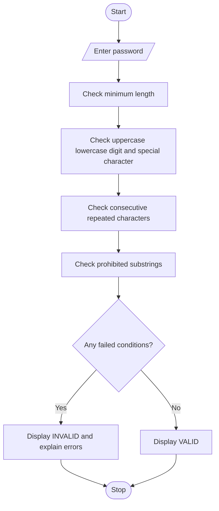

# Password Policy Validation Engine Using Python

## 1. Problem Statement

Develop a Python program to evaluate sample passwords based on predefined password security rules.

The program should:

1. Check whether the password meets the minimum length requirement.
2. Verify the presence of uppercase letters, lowercase letters, digits, and special characters.
3. Detect excessive consecutive repeated characters.
4. Identify prohibited substrings such as `password`, `admin`, and `1234`.
5. Display whether the password is valid or invalid.
6. Explain each failed validation condition.

Assumed Password Policy:

| Rule                  | Requirement                                         |
| --------------------- | --------------------------------------------------- |
| Minimum length        | At least 8 characters                               |
| Uppercase             | At least one uppercase letter                       |
| Lowercase             | At least one lowercase letter                       |
| Digit                 | At least one number                                 |
| Special character     | At least one special character                      |
| Repetition            | No character repeated 3 or more times consecutively |
| Prohibited substrings | Must not contain `password`, `admin`, or `1234`     |

## 2. Algorithm

1. Start the program.
2. Read a password from the user.
3. Check whether its length is at least 8 characters.
4. Check for uppercase and lowercase letters.
5. Check for at least one digit.
6. Check for at least one special character.
7. Identify three or more consecutive repeated characters.
8. Check for prohibited substrings.
9. Store all failed conditions in an error list.
10. If the error list is empty, display "Password is VALID".
11. Otherwise, display "Password is INVALID" with the reasons.
12. Stop the program.


## 5. Sample Input

```
Enter password: pass1234
```

## 6. Sample Output

```
--- Password Validation Report ---

Password Status: INVALID
Failed Conditions:
- Missing uppercase letter
- Missing special character
- Contains prohibited substring: password
- Contains prohibited substring: 1234
```

Another example – Valid Password

Sample Input:

```
Enter password: Ram@2026Secure
```

Sample Output:

```
--- Password Validation Report ---

Password Status: VALID
All password policy conditions are satisfied.
```

## 7. Mermaid Flowchart Code


## 8. Result

The Python program successfully evaluates passwords against the defined security policy. It checks minimum length, character categories, consecutive repetitions, and prohibited substrings, and provides clear explanations for every failed condition.

Note: The password policy rules and prohibited words are illustrative and can be modified according to institutional or organizational requirements.
